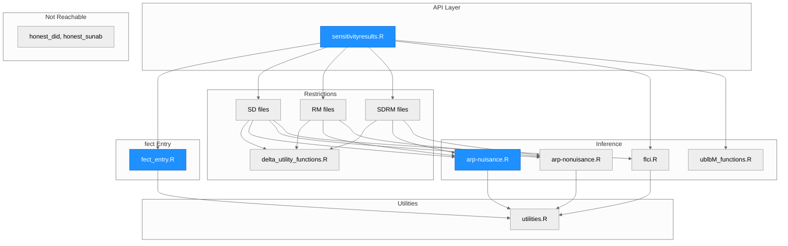
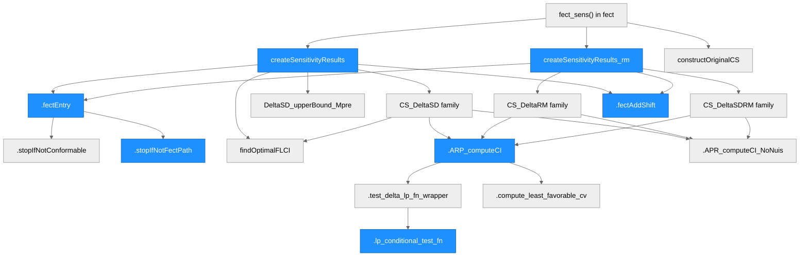
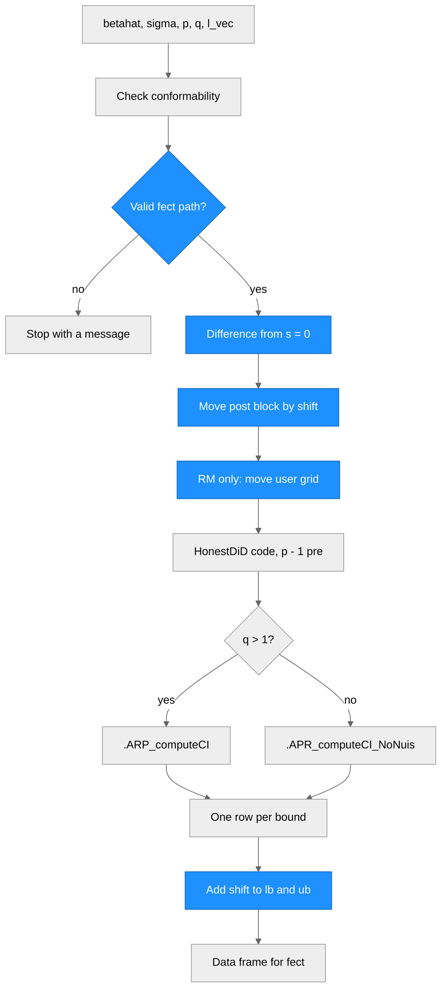

# Architecture — HonestDiDFEct

> Architecture of HonestDiDFEct 1.0.0, based on HonestDiD 0.2.8.

## Overview

HonestDiDFEct is an R package forked from HonestDiD 0.2.8 by Ashesh Rambachan and Jonathan Roth. It runs the sensitivity analysis of Rambachan and Roth (2023) on the placebo output of **fect**, and `fect_sens()` in **fect** is its main caller. HonestDiD expects coefficients relative to a reference period that is left out of the vector. **fect** reports placebo coefficients ending at s = 0, then post-treatment coefficients, with no reference period. A short entry step in `R/fect_entry.R` turns the second form into the first, and the HonestDiD code then runs with two small fixes kept from the old fork. The package has no compiled code. Optimization goes through Rglpk, lpSolveAPI and CVXR, and the plots through ggplot2. It does not use roxygen, so NAMESPACE and the Rd files are written by hand.

---

## Module Structure

> Blue fill = modified in this run. Every other file in R/ equals HonestDiD 0.2.8. The SD, RM and SDRM files are listed in the table below.

### Module Reference

| Module / File | Layer | Purpose | Key Exports | Changed |
| --- | --- | --- | --- | --- |
| `R/sensitivityresults.R` | API | Sensitivity results, original interval, plots | `createSensitivityResults`, `createSensitivityResults_relativeMagnitudes`, `constructOriginalCS`, `createSensitivityPlot`, `createSensitivityPlot_relativeMagnitudes`, `createEventStudyPlot` | yes, 9 insertions and 2 deletions |
| `R/fect_entry.R` | Entry | Guard, differencing, move and add-back | none | yes, new |
| `R/deltasd.R`, `R/deltasdb.R`, `R/deltasdm.R` | Restrictions | SD and its sign and monotonicity variants | none | no |
| `R/deltarm.R`, `R/deltarmb.R`, `R/deltarmm.R` | Restrictions | RM and its variants, one case per location and sign of the largest placebo change | none | no |
| `R/deltasdrm.R`, `R/deltasdrmb.R`, `R/deltasdrmm.R` | Restrictions | SDRM and its variants | none | no |
| `R/delta_utility_functions.R` | Restrictions | Constraint matrices for monotonicity and sign | none | no |
| `R/arp-nuisance.R` | Inference | Conditional and hybrid tests with nuisance parameters, used when q > 1 | none | yes, 10 insertions and 1 deletion |
| `R/arp-nonuisance.R` | Inference | Conditional and hybrid tests without nuisance parameters, used when q = 1 | none | no |
| `R/flci.R` | Inference | Fixed-length confidence interval | none | no |
| `R/ublbM_functions.R` | Inference | Upper and lower bounds for M from the pre-period coefficients | none | no |
| `R/utilities.R` | Utils | Conformability checks, CVXR wrapper, error handler | `basisVector` | no |
| `R/honest_did.R`, `R/honest_sunab.R` | Not reachable | Upstream wrappers for other packages. Unexported, and no S3 method is registered | none | no |
| `R/HonestDiD-Temp.R` | none | Deleted. Every function in it was overwritten by a file that collates later | none | yes, removed |

Here q is the number of post-treatment periods.

---

## Function Call Graph

> Blue nodes = changed. `createSensitivityResults_rm` stands for `createSensitivityResults_relativeMagnitudes`. `CS_DeltaSD family` stands for `computeConditionalCS_DeltaSD` and its sign and monotonicity variants, and the same holds for RM and SDRM.

### Function Reference

| Function | Defined In | Called By | Calls | Changed | Purpose |
| --- | --- | --- | --- | --- | --- |
| `createSensitivityResults()` | `R/sensitivityresults.R` | user, `fect_sens()` | `.fectEntry`, `computeConditionalCS_DeltaSD*`, `findOptimalFLCI`, `.fectAddShift` | yes | Robust confidence sets for SD and its variants, one row per M |
| `createSensitivityResults_relativeMagnitudes()` | `R/sensitivityresults.R` | user, `fect_sens()` | `.fectEntry`, `computeConditionalCS_DeltaRM*`, `computeConditionalCS_DeltaSDRM*`, `.fectAddShift` | yes | Robust confidence sets for RM, SDRM and their variants, one row per Mbar |
| `constructOriginalCS()` | `R/sensitivityresults.R` | user, `fect_sens()` | `.stopIfNotConformable`, `.warnIfNotSymmPSD` | no | Usual interval for l'beta_post from the raw coefficients |
| `createSensitivityPlot()`, `createSensitivityPlot_relativeMagnitudes()` | `R/sensitivityresults.R` | user | ggplot2 | no | Plots of the robust confidence sets against the bound |
| `createEventStudyPlot()` | `R/sensitivityresults.R` | user | ggplot2 | no | Event study plot for reference-normalized coefficients |
| `.fectEntry()` | `R/fect_entry.R` | both sensitivity functions | `.stopIfNotConformable`, `.stopIfNotFectPath` | yes | Differences from s = 0 and moves the post block. Returns betahat, sigma, numPrePeriods and shift |
| `.stopIfNotFectPath()` | `R/fect_entry.R` | `.fectEntry` | none | yes | Guard on the form of the input |
| `.fectAddShift()` | `R/fect_entry.R` | both sensitivity functions | none | yes | Adds shift to lb and ub |
| `computeConditionalCS_Delta*()` | `R/delta*.R` | both sensitivity functions | `.ARP_computeCI`, `.APR_computeCI_NoNuis`, `findOptimalFLCI` | no | Test inversion for one restriction and one bound. Internal since this run |
| `findOptimalFLCI()` | `R/flci.R` | `createSensitivityResults`, `computeConditionalCS_DeltaSD*` | `.findOptimalFLCI_helper` | no | Fixed-length confidence interval. Internal since this run |
| `DeltaSD_upperBound_Mpre()`, `DeltaSD_lowerBound_Mpre()` | `R/ublbM_functions.R` | `createSensitivityResults` (upper bound only) | `.create_A_SD` | no | Default range of M. Internal since this run |
| `.ARP_computeCI()` | `R/arp-nuisance.R` | `computeConditionalCS_Delta*` | `.test_delta_lp_fn_wrapper`, `.compute_least_favorable_cv` | yes, `c()` on the grid ends | Test over the theta grid, with nuisance parameters |
| `.APR_computeCI_NoNuis()` | `R/arp-nonuisance.R` | `computeConditionalCS_Delta*` | `.testOverThetaGrid` | no | Test over the theta grid, with one post-treatment period |
| `.lp_conditional_test_fn()` | `R/arp-nuisance.R` | `.test_delta_lp_fn_wrapper` | linear programs | yes, near-zero variance branch | Conditional test of one value of theta |

---

## Data Flow

> Here p counts the placebo periods, including s = 0, and q counts the post-treatment periods. Blue = added in this run. Everything between the move and the add-back is HonestDiD's code.

---

## Architectural Patterns

- **Thin adapter over the engine**: the fork adds one file and edits a few lines. `git diff upstream/master -- R/` shows the whole difference, so the code stays easy to compare with HonestDiD and easy to merge.
- **Promise body**: each exported function wraps its body in `.CustomErrorHandling({...})`. The body is a promise, so its `base::return()` leaves the exported function directly, and a line after the handler would never run. The add-back therefore sits in that return statement. Every branch assigns `Results` and reaches this one return.
- **Guard outside the handler**: the guard runs in `.fectEntry`, before the handler, so it stops with its own message and the handler prints nothing around it.
- **Local replacement**: the entry step replaces `betahat`, `sigma` and `numPrePeriods` in the function's frame. Every default after it, such as `Mvec` and the grids, is computed from the replaced objects, and the foreach bodies read them from that frame.
- **Comparison test as a merge check**: `tests/testthat/test-honestdid.R` compares the package with the CRAN version on the same path. The test skips unless the installed HonestDiD is exactly the base version in `base_version`.

---

## Notes

### Entry step

In the steps below, p is `numPrePeriods`, q is `numPostPeriods`, and k = p + q.

1. Difference. J is the (k - 1) x k matrix with rows e_s' - e_0', s != 0. The step computes `bd = J betahat` and `Sd = J sigma J'`, symmetrized. This removes the coordinate at s = 0, so the engine sees p - 1 pre-period coefficients and a reference period at s = 0.
2. Move. With `shift = sum(l * bd[post])`, the step subtracts `shift * l / sum(l^2)` from the post block, so the estimate of theta is zero.
3. In the relative-magnitudes function, `grid.lb` and `grid.ub` also move by `shift`, because the user gives them in units of theta.
4. Add back. `.fectAddShift()` adds `shift` to `lb` and `ub`.

The default grids of HonestDiD are centered on zero. Without the move, two upper bounds on hh2019 were cut at the edge of the grid. The move changes theta and leaves the bias alone, so the accepted set moves by exactly `shift`.

Differencing removes the level, which the restrictions do not use. SD, RM, SDRM and monotonicity rows sum to zero, so they read the same on the raw path and on the differenced one. Sign rows do not, so `biasDirection` restricts the post-treatment bias relative to s = 0.

`constructOriginalCS()` does not go through the entry step. Its interval is centered on `l'beta_post`, and with weights that sum to one the robust confidence set at `Mbar = 0` is centered on that value minus the coefficient at s = 0.

### Guard

`.stopIfNotFectPath()` stops with `call. = FALSE`, in this order.

1. p < 2 or q < 1.
2. The names of betahat, or the rownames of a one-column matrix, must all be numbers. The first p must be consecutive and end at 0, and the next q must be 1, ..., q. This catches `fect_sens()` on a run with `loo = TRUE`, a block ending at -1, and `post.periods` that skip s = 1 or have gaps. Unnamed input skips this check.
3. `l_vec` is all zeros.
4. q = 1 and `l_vec` is not 1. With one post-treatment period the engine tests tau_1 and ignores l, so the shift would be in the wrong units.

### What stays upstream

All of R/ comes from HonestDiD 0.2.8 without change, except the edits below. So do `data/`, `inst/extdata/`, `LICENSE` and `LICENSE.md`.

The edits are these.

- `R/sensitivityresults.R`: the entry lines at the top of both exported functions, the grid line in the relative-magnitudes function, and the last line of both bodies.
- `R/arp-nuisance.R`: the near-zero variance branch in `.lp_conditional_test_fn` and `c()` around the grid ends in `.ARP_computeCI`. The branch compares `sigma2_B` with 1e-8 and does not scale with the outcome.
- `R/HonestDiD-Temp.R`: deleted, so that no collation order can bypass the entry step.
- `NAMESPACE`: seven exports. `computeConditionalCS_*`, `findOptimalFLCI` and `DeltaSD_*_Mpre` are internal, because they keep the reference-normalized meaning and would be silently wrong on a raw **fect** path.

### Merging a later HonestDiD version

1. Take upstream's tree as the base, so that `git diff upstream/master` shows only what this fork adds.
2. Add `R/fect_entry.R` back and re-apply the edits above to `R/sensitivityresults.R`, `R/arp-nuisance.R`, `NAMESPACE`, and the DESCRIPTION, Rd, test and top-level files that this fork changes.
3. Check that each new exported path in the two sensitivity functions still reaches the one final return, and that `.CustomErrorHandling` still rethrows.
4. Set `base_version` in `tests/testthat/test-honestdid.R` to the new version, install that version of HonestDiD, and run the tests with `NOT_CRAN=true`.
5. Update the base version in DESCRIPTION, README and NEWS.

On line endings, `core.autocrlf` is true and there is no `.gitattributes`, so tracked text files are LF in the index and CRLF on disk. Edit them in a way that keeps each file's endings, or the whole file shows as changed.

### Monotonicity at two placebo periods

With p = 2 the engine sees one pre-period coefficient. Upstream's `.create_A_M(1, q, ...)` then runs `for (r in 1:(numPrePeriods - 1))` over r = 1, 0, so row 1 becomes delta_{-1} - delta_1 <= 0 and not delta_{-1} <= 0. The monotonicity set is therefore larger than intended and the result is conservative. It stays, because the engine is meant to equal the base version. `fect_sens()` does not use monotonicity.

### Other upstream behavior left alone

- `.APR_computeCI_NoNuis()` has the same `seq(grid.lb, grid.ub, ...)` line that the fork fixes in `.ARP_computeCI()`. With q = 1 and a sign or shape restriction, the grid ends are 1 x 1 matrices, which gives a deprecation warning. `fect_sens()` does not reach this case.
- `createSensitivityResults_relativeMagnitudes(method = NULL)` fails, although its stop message lists NULL.
- With q > 1, the least-favorable draw does not receive `seed`, because `.ARP_computeCI()` does not pass it.
- When a solver for the FLCI is left to CVXR (`R/flci.R`, `.findLowestH`), CVXR can pick a commercial solver with a lapsed licence. FLCI and C-F then stop, as they do in HonestDiD. `fect_sens()` uses only C-LF.
- The comment above `.CustomErrorHandling` in `R/utilities.R` names `test_syntax.R`, which this fork removes.

### Documentation

The site is built with pkgdown from a copy of the repository without this file, because pkgdown renders every Markdown file at the root. The tutorial is `vignettes/articles/tutorial.Rmd`, and `^vignettes$` in `.Rbuildignore` keeps it out of the source package.
